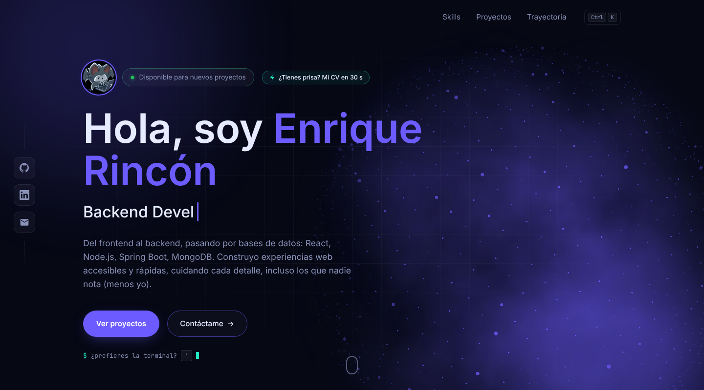
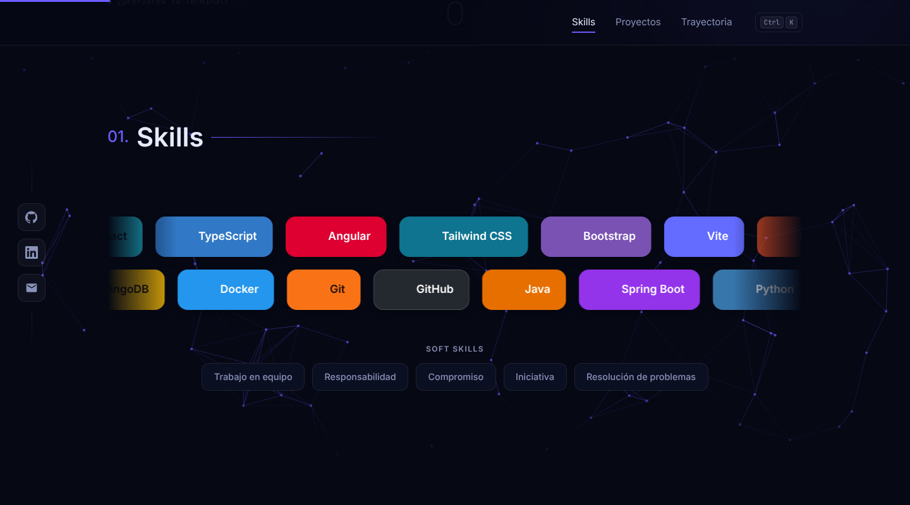
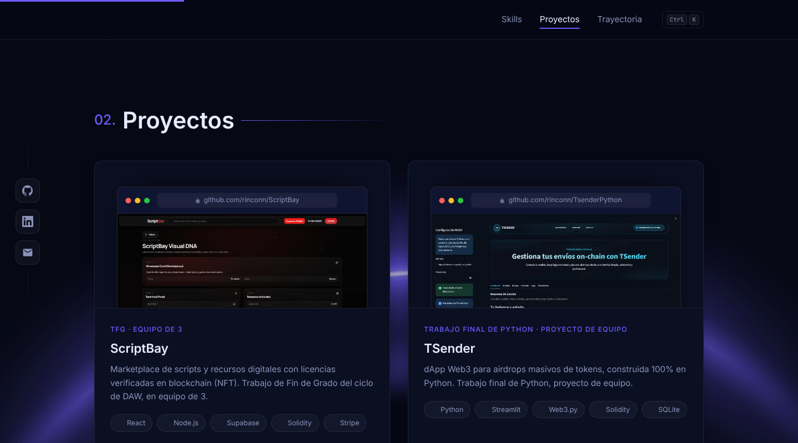
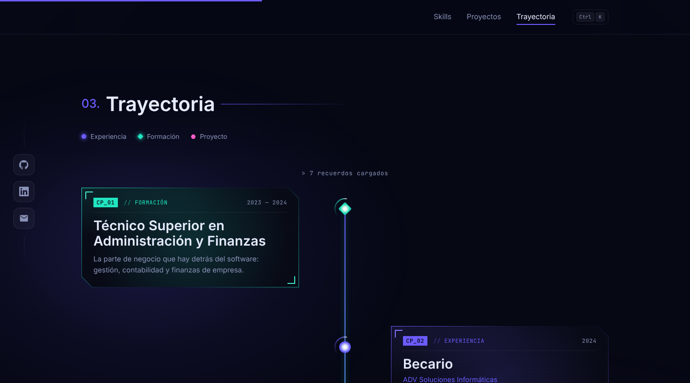
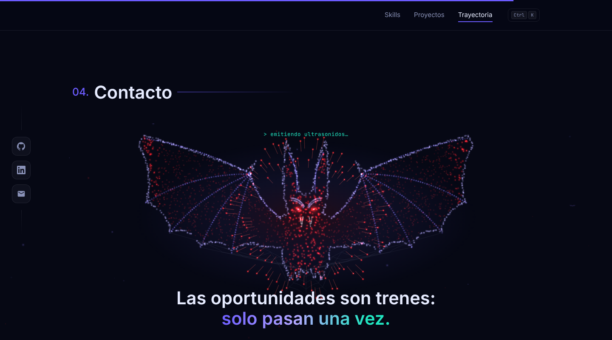
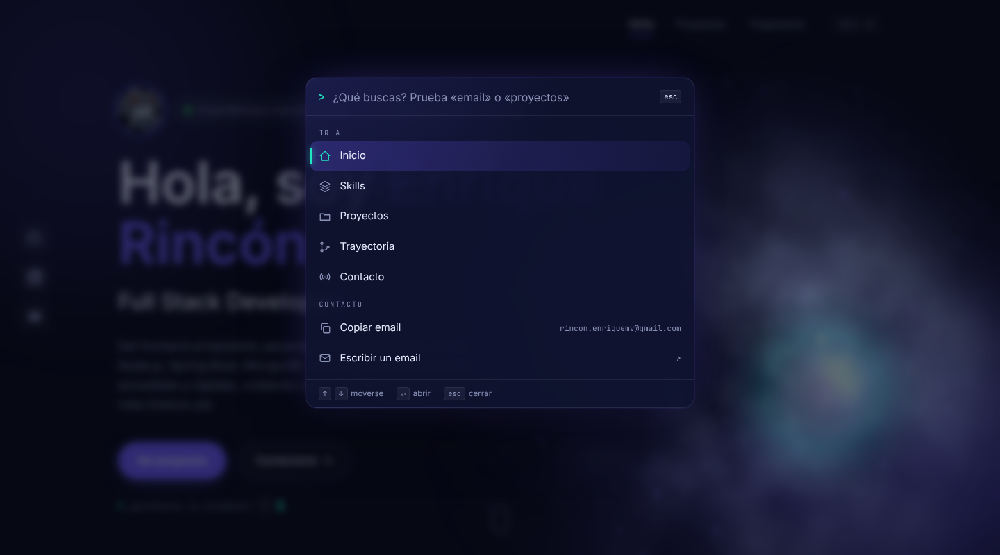
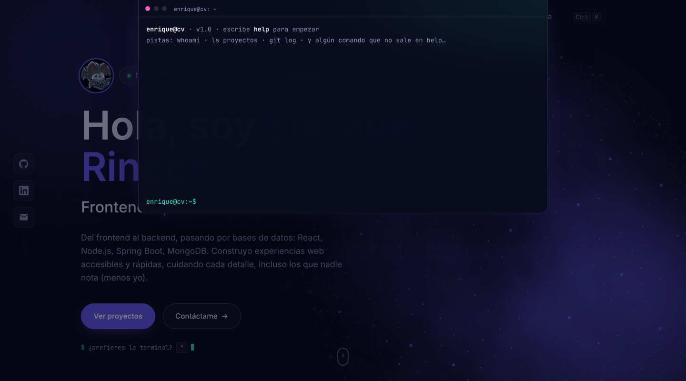

<div align="center">

# 🦇 CV Interactivo

### Mi CV y portfolio, hecho a mano y sin frameworks


**[🌐 Ver la web en vivo](https://rinconn.github.io/CV-INTERAKTIVO/)**



</div>

---

## 📖 Sobre el proyecto

Quería algo distinto al típico CV en PDF, así que construí una web de una sola página donde se ve quién soy, con qué trabajo y qué he hecho. Todo está programado a mano: **sin frameworks, sin build y sin dependencias que instalar**.

## ✨ Características

| | Qué hace |
|---|---|
| 🌌 **Hero vivo** | Texto que se escribe solo, indicador de disponibilidad y un globo de humo con tormenta eléctrica dibujado en canvas |
| 🕸️ **Skills** | Dos carruseles en sentidos opuestos sobre una red de nodos, con tooltips de dónde usé cada tecnología |
| 🗂️ **Proyectos** | Tarjetas con tilt 3D, parallax y borde que sigue al ratón |
| 🧠 **Trayectoria** | Un cerebro que "recuerda" y un hilo de energía que enciende cada hito |
| 🦇 **Contacto** | Un murciélago de chispas que ecolocaliza, QR con mi tarjeta y descarga de vCard |
| ⌨️ **Paleta de comandos** | `Ctrl/⌘ + K` para saltar a una sección, copiar el email o abrir mis redes |
| 💻 **Terminal** | Tecla `º`: el CV responde a comandos y `git log` trae mis commits reales de GitHub |
| ⚡ **Modo reclutador** | El CV entero en una pantalla para leerlo en 30 s, con imprimir / guardar en PDF |
| 🦇 **Murciélago acompañante** | Te sigue por la web y ecolocaliza cada sección |
| 🥚 **Easter eggs** | Abre la consola (F12) o haz triple clic en el avatar |

### 🚀 Rendimiento y accesibilidad

- 📉 Calidad adaptativa: si el equipo va justo de fps, los canvas pasan solos a modo ligero
- ⏸️ Las animaciones se pausan en las secciones que no se ven
- ♿ Respeta `prefers-reduced-motion`
- 🖼️ Imágenes WebP responsive y vista previa al compartir (Open Graph y tarjeta de X)

## 🛠️ Stack de la web

   

- 🎞️ **GSAP + ScrollTrigger** para las animaciones
- 🧈 **Lenis** para el scroll suave
- 🎨 **Canvas 2D** para el globo, la red de skills, el cerebro y el murciélago
- 🔤 **Tipografías:** Inter, JetBrains Mono y Clash Display

## 🎨 Paleta

| Color | Hex | Uso |
|---|---|---|
|  | `#6C5CFF` | Acento principal |
|  | `#21E6C1` | Acento secundario |
|  | `#060814` | Fondo |
|  | `#0B0F22` | Fondo suave |
|  | `#0F1430` | Tarjetas |

## 🧰 Tecnologías con las que trabajo

**🎨 Frontend**

        

**⚙️ Backend y bases de datos**

     

**🔧 Herramientas**

     

## 📁 Proyectos

### 🛒 [ScriptBay](https://github.com/rinconn/ScriptBay)
Marketplace de scripts y recursos digitales con licencias verificadas en blockchain (NFT). TFG del ciclo de DAW, en equipo de 3.

    

### 💸 [TSender](https://github.com/rinconn/TsenderPython)
dApp Web3 para airdrops masivos de tokens, construida 100% en Python. Trabajo final de Python, en equipo.

    

## 🧭 Trayectoria

- 💼 **Prácticas en el equipo de IT**: Power Apps, Power Automate y Power Pages *(actual)*
- 🎓 **Desarrollo de Aplicaciones Web** (2024 — 2025)
- 🧑‍💼 **Becario** (2024)
- 📊 **Técnico Superior en Administración y Finanzas**

## 🗂️ Estructura

```
├── index.html        # Contenido de la página
├── css/styles.css    # Estilos
├── js/main.js        # Animaciones, canvas e interacciones
├── assets/           # Avatar, imágenes de proyectos y recursos
└── docs/capturas/    # Capturas para este README
```

## ▶️ Ejecutarlo en local

No requiere instalación. Clona el repositorio y sirve la carpeta con cualquier servidor estático:

```bash
git clone https://github.com/rinconn/CV-INTERAKTIVO.git
cd CV-INTERAKTIVO
python3 -m http.server 8000
```

Después abre http://localhost:8000.

## 📸 Capturas

| Skills | Proyectos |
|---|---|
|  |  |

| Trayectoria | Contacto |
|---|---|
|  |  |

| Paleta de comandos (`Ctrl + K`) | Terminal (`º`) |
|---|---|
|  |  |

## 📬 Contacto

[](https://github.com/rinconn)
[](https://www.linkedin.com/in/enrique-rincón-mateeva-264845363)
[](mailto:rincon.enriquemv@gmail.com)

<div align="center">

Hecho con 💜 por **Enrique Rincón** 🦇

</div>
